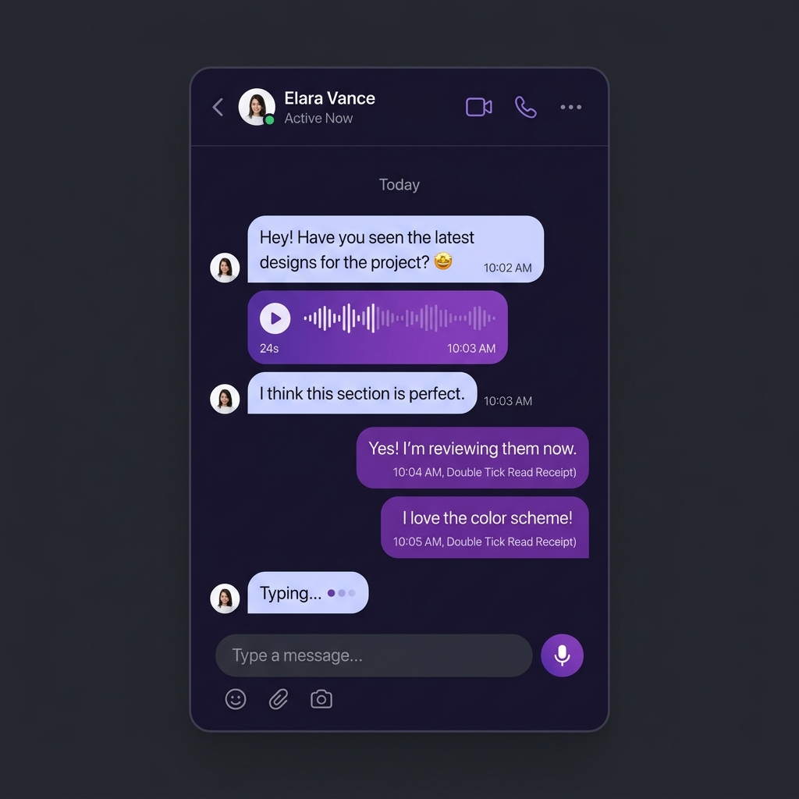
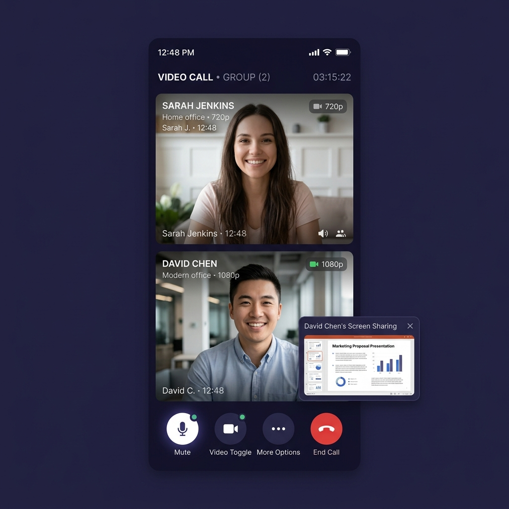
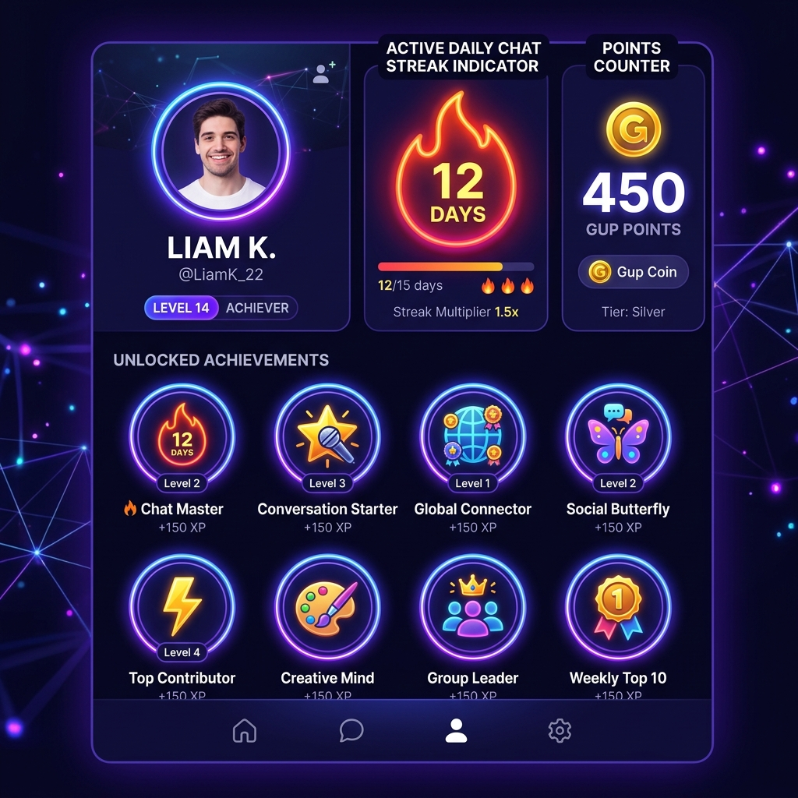

  

# 
GupShupGo : Next-Gen Private Messenger

**The Next-Generation, Offline-Capable, Zero-Knowledge Encrypted Messenger & Real-Time Communication Platform.**

[📲 Download on Google Play](https://play.google.com/store/apps/details?id=com.gupshupgo.app) • [🔐 Privacy Whitepaper](PRIVACY.md) • [🧪 Verification Guide](VERIFICATION.md) • [🛡️ Security Policy](SECURITY.md) • [❓ FAQ](FAQ.md) • [📝 Changelog](CHANGELOG.md)

 

---

## 🏢 About This Repository

Welcome to the official public repository and transparency center for **GupShupGo**.

GupShupGo is developed as a proprietary, enterprise-grade communication product. While the underlying application binary and core backend services are maintained privately to safeguard platform infrastructure and user safety, **we believe that true privacy requires radical transparency**.

This public repository serves as the definitive source of truth for:
* **The GupShupGo Privacy & Cryptography Whitepaper:** Mathematical and protocol specifications governing our zero-knowledge encryption.
* **Offline Mesh Protocol Architecture:** Technical disclosures on how peer-to-peer ad-hoc communication operates with zero internet or tower tracking.
* **Independent Verification Guidelines:** Step-by-step procedures for security researchers and users to verify ciphertext integrity, safety numbers, and network packets.
* **Public Issue & Feedback Tracking:** Feature requests, public bug tracking, and vulnerability disclosures.
* **Release History & Versioning:** Detailed records of every production update shipped to Google Play.

---

## 📲 Download GupShupGo

**Available now for Android worldwide on the Google Play Store!**  
*Direct download link: [play.google.com/store/apps/details?id=com.gupshupgo.app](https://play.google.com/store/apps/details?id=com.gupshupgo.app)*

---

## 🛡️ Core Privacy & Security Pillars

GupShupGo is engineered from the ground up on four non-negotiable architectural pillars:

### 1. Zero-Knowledge Cryptography (Signal Protocol)
Every 1-on-1 text, voice message, photo, video, and document is encrypted directly on your device using the **Signal Protocol** (Extended Triple Diffie-Hellman `X3DH` key exchange + `Double Ratchet` algorithm). 
* **End-to-End Encrypted by Default:** Encryption is not an optional "secret mode" — it is permanently active on all conversations.
* **Ephemeral Master Keys:** Symmetric session keys ratchet forward with every single message.
* **Perfect Forward Secrecy & Post-Compromise Security:** Even if an attacker were to capture an active device key today, they cannot decrypt past conversations or future conversations once keys ratchet.
* **Zero Server Plaintext:** Our servers and relays only ever see opaque ciphertext blobs (`AES-256-GCM`). No human, engineer, or server process can decrypt your messages.

### 2. Off-Grid Decentralized P2P Mesh Network
When cell towers fail, during natural disasters, in remote areas, or during internet shutdowns, GupShupGo keeps you connected.
* **No Internet, No Cellular Data Needed:** Devices communicate directly peer-to-peer using dual-radio Bluetooth Low Energy (BLE) and Wi-Fi Direct.
* **Zero Metadata Logging:** Because transmissions occur device-to-device over radio frequencies, no central server ever registers who you spoke with or what was sent.
* **Automatic Cloud Synchronization:** Offline messages are queued locally and sync securely via E2EE back to the cloud the moment connectivity returns.

### 3. Secret Chat Vault (Argon2id + AES-256-GCM)
Sensitive chats can be sequestered inside a cryptographic **Vault** hidden from standard chat lists and notifications:
* **Memory-Hard KDF:** Vault PINs are processed using **Argon2id**, mathematically rendering GPU/ASIC rainbow-table brute-forcing impossible.
* **Local Database Encryption:** Data is encrypted at rest using `AES-256-GCM` before being written to the device disk.
* **Hardware-Backed Protection:** Session tokens and master cryptographic identity keys reside inside the hardware-backed Android Keystore / iOS Keychain.

### 4. Ephemeral Media & View-Once Protection
* **Single-View Destruction:** View-once photos and videos have their local decryption keys permanently wiped from memory the instant they are closed.
* **Screenshot & Screen Recording Prevention:** Hardened with Android OS `FLAG_SECURE` to block screenshots and screen recordings on protected screens.
* **Expiring Statuses:** 24-hour auto-expiring Moments with automatic media storage cleanup.

---

## ⚔️ Feature Parity & Superpowers Matrix

How does GupShupGo compare to other global communication tools?

| Capability / Feature | GupShupGo 🚀 | WhatsApp 🟢 | Signal 🔵 | Telegram ✈️ | Discord 🎮 |
| :--- | :---: | :---: | :---: | :---: | :---: |
| **Signal Protocol E2EE by Default** | ✅ **Yes (X3DH + Ratchet)** | ✅ Yes | ✅ Yes | ❌ No (Secret Chats only) | ❌ No |
| **Off-Grid P2P Mesh Networking** | ✅ **Yes (Bluetooth / Wi-Fi Direct)** | ❌ No | ❌ No | ❌ No | ❌ No |
| **Native Lock-Screen Incoming Calls** | ✅ **Yes (Android + CallKit)** | ✅ Yes | ✅ Yes | ✅ Yes | ⚠️ Partial |
| **High-Definition Voice & Video Calls**| ✅ **Yes (Agora Low-Latency RTC)**| ✅ Yes | ✅ Yes | ✅ Yes | ✅ Yes |
| **In-Call Real-Time Screen Sharing** | ✅ **Yes (HD Real-Time)** | ✅ Yes | ❌ No | ✅ Yes | ✅ Yes |
| **Secret PIN Vault (Argon2id KDF)** | ✅ **Yes (Encrypted SQLite Store)**| ⚠️ Basic Lock | ❌ No | ⚠️ Passcode Lock | ❌ No |
| **View-Once Media with Key Erasure** | ✅ **Yes (Cryptographic Shredding)**| ✅ Yes | ✅ Yes | ✅ Yes | ❌ No |
| **In-Chat AI Assistant (GupAI)** | ✅ **Yes (Privacy-First Assistant)** | ⚠️ Meta AI Only | ❌ No | ⚠️ Third-Party Bots | ⚠️ Server Bots |
| **Integrated Arcade Mini-Games** | ✅ **Yes (Gup Arcade)** | ❌ No | ❌ No | ⚠️ Bots Only | ✅ Yes |
| **16-Language Global Localization** | ✅ **Yes (16 World Languages)** | ✅ Yes | ✅ Yes | ✅ Yes | ✅ Yes |
| **Zero Advertising / Zero Commercial Trackers** | ✅ **100% Tracker-Free** | ❌ Metadata Used | ✅ Yes | ❌ Ad Platform | ❌ Commercial |

---

## 📸 App Preview & Visuals

  
  &nbsp;&nbsp;&nbsp;&nbsp;
  
  &nbsp;&nbsp;&nbsp;&nbsp;
  

---

## 🔍 Independent Verification & Audit

We do not ask you to simply take our word for our security promises. 

We provide transparent guidelines for anyone to independently verify:
1. **Cryptographic Identity Verification:** Verify Safety Numbers and public key fingerprints between contacts via in-app QR scanning or out-of-band numeric comparison.
2. **Network Traffic Auditing:** Monitor traffic using tools like `mitmproxy` or `Wireshark` to confirm that all message payloads sent across the wire are encrypted ciphertexts.
3. **Local Storage Inspection:** Verify that on-disk databases utilize authenticated encryption and that private keys never leak into unencrypted logs or SQLite files.

👉 Read the step-by-step [Verification & Audit Guide](VERIFICATION.md).

---

## 🔒 Summary of Data Handling & Privacy Policy

| Data Category | Stored Locally On Your Device | Transferred Through Cloud Servers | Accessible By GupShupGo |
| :--- | :---: | :---: | :---: |
| **Private Chat Messages** | ✅ Encrypted SQLite (Drift) | ⚡ Encrypted Ciphertext Relay Only | ❌ **NEVER (Mathematically Impossible)** |
| **Cryptographic Private Keys** | ✅ Hardware Keystore / Secure Enclave | ❌ **NEVER leaves your device** | ❌ **NEVER** |
| **Photos, Videos & Documents** | ✅ Stored locally | ⚡ End-to-End Encrypted via Storage | ❌ **NEVER** |
| **Voice & Video Audio Streams** | ❌ Real-time ephemeral | ⚡ Encrypted Agora RTC Transport | ❌ **NEVER Recorded** |
| **Offline Mesh Messages** | ✅ Stored locally | ❌ Zero Server Transfer (P2P Radio) | ❌ **NEVER** |
| **Vault Conversations** | ✅ Argon2id Encrypted Store | ⚡ Encrypted Ciphertext Relay Only | ❌ **NEVER** |
| **Phone Number (for Auth)** | ✅ Cached for session | ⚡ Hashed / Tokenized in Firebase Auth | ⚠️ Verification & Account ID Only |
| **Advertising / Tracking IDs** | ❌ **None** | ❌ **None** | ❌ **Zero Trackers Integrated** |

👉 Read the complete, comprehensive [Privacy Whitepaper & Policy](PRIVACY.md).

---

## 🛡️ Security Vulnerability Disclosure

If you believe you have discovered a security or privacy vulnerability in GupShupGo, please report it responsibly. We appreciate the work of independent security researchers and prioritize all security inquiries.

* **Reporting Email:** `security@gupshupgo.app` (or contact via [GitHub Security Advisories](https://github.com/vansh-121/GupShupGo/security/advisories))
* **Response SLO:** Initial response within **48 hours**.
* Please refer to [`SECURITY.md`](SECURITY.md) for full instructions and PGP encryption details.

---

## 📬 Community, Issues & Support

* **Bug Reports:** If you encounter unexpected behavior in the mobile app, please submit a report using our [Bug Report Template](.github/ISSUE_TEMPLATE/bug_report.md).
* **Feature Requests:** Share your ideas for new privacy tools and features on our [GitHub Discussions / Feature Request Template](.github/ISSUE_TEMPLATE/feature_request.md).
* **Privacy Questions:** Have questions regarding our cryptography or architecture? Open a ticket using our [Privacy Inquiry Template](.github/ISSUE_TEMPLATE/privacy_or_security_inquiry.md).

---

## 📄 License & Terms

GupShupGo application binaries, branding, trademarks, and associated proprietary assets are subject to the terms in [LICENSE](LICENSE).

This public documentation, privacy whitepapers, and verification specifications are published openly for the benefit of the community and user transparency.

---

**Built with uncompromising dedication to user privacy by Vansh Sethi**

